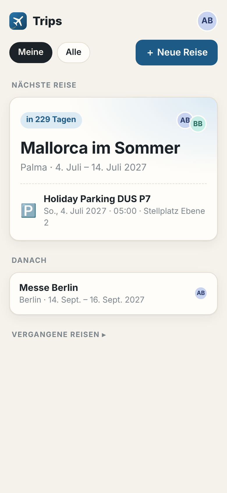
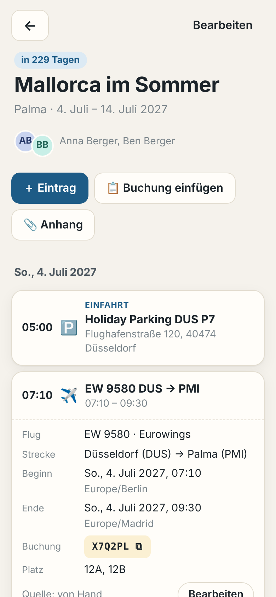
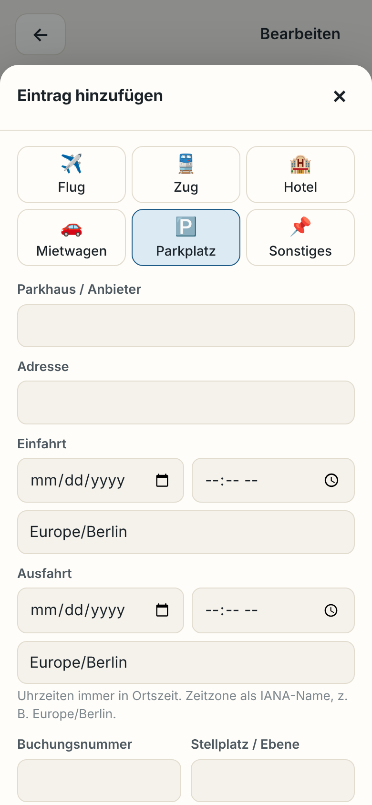
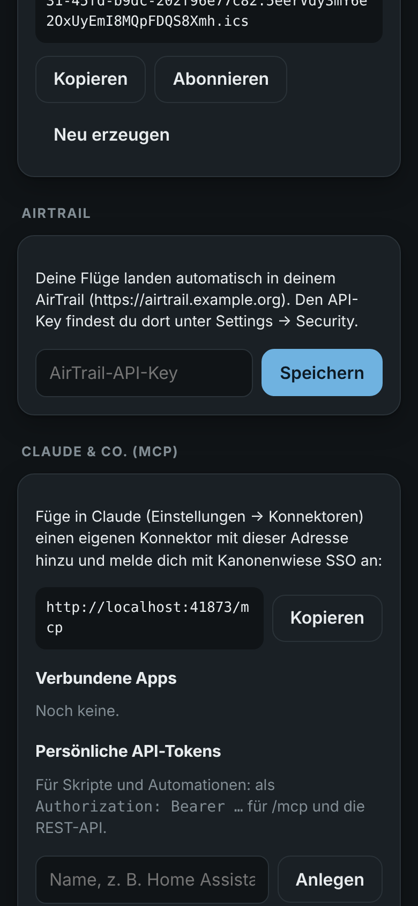

# Trips ✈️

Trips ist dein Reiseordner, der sich selbst sortiert: Die Bestätigung vom Flug, das
Hotel auf Mallorca, der Mietwagen am Flughafen und der Parkplatz in Düsseldorf landen
an einem Ort – du leitest einfach die Mail weiter. Auf dem Handy siehst du auf einen
Blick, wann es losgeht, wo du parkst und welche Buchungsnummer du am Schalter brauchst.
Auch im Flugmodus.

Kurz gesagt: Buchungsmail weiterleiten, fertig – Trips macht daraus eine Reise mit
Zeitleiste, Kalendereintrag und AirTrail-Flug, und Claude kann sie lesen und pflegen.

| Startseite | Reise | Parkplatz eintragen | Mit Claude verbinden |
| --- | --- | --- | --- |
|  |  |  |  |

## Was Trips für dich macht

- **Buchungen kommen per Mail** – Bestätigung an das Import-Postfach weiterleiten. Claude liest
  Text und PDF-Anhänge, erkennt Flüge, Züge, Hotels, Mietwagen und Parkplätze und sortiert sie
  in die passende Reise – oder legt eine neue an. Du bekommst eine kurze Mail, was passiert ist.
- **Keine Dubletten, Stornos räumen auf** – Kommt die Umbuchung von LH 2010, wird der Eintrag
  aktualisiert statt verdoppelt. Kommt die Stornierung vom Parkplatz, verschwindet er.
- **Mitreisende erkennt es selbst** – „JACOBS/ULLI MRS“ auf dem Ticket wird zu Ulli in Trips,
  Umlaute und Reihenfolge egal.
- **Eine Zeitleiste pro Reise** – nach Tagen sortiert, Zeiten immer in Ortszeit. Hotels mit
  Check-in und Check-out, Parkplätze mit 🅿️ Einfahrt und Ausfahrt am richtigen Tag.
  Buchungsnummer antippen kopiert sie, Adresse antippen öffnet die Karten-App.
- **Buchung einfügen** – Text aus einer Mail oder ein PDF direkt in eine Reise werfen, gleiche
  Auswertung wie beim Mail-Import.
- **Im Kalender** – ein geheimer Abo-Link pro Person für Apple-, Google- oder Outlook-Kalender:
  jede Reise als Ganztagstermin, dazu jeder Flug, jedes Check-in und jede Parkplatz-Ausfahrt.
- **AirTrail füllt sich von allein** – Wer seinen AirTrail-API-Key hinterlegt, bekommt jeden Flug
  automatisch in sein AirTrail, mit Sitzplatz. Ändert sich der Flug, ändert er sich dort mit.
- **Claude & Co. reden mit** – Trips bringt einen MCP-Server mit: „Was steht nächste Woche an?“
  oder „Trag den Rückflug aus dieser Mail ein“ funktioniert direkt aus Claude.
- **Für die Familie, nicht für alle Welt** – Jeder mit Zugang darf alle Reisen lesen; ändern dürfen
  nur die Reisenden selbst und Admins. Die Daten liegen in einer SQLite-Datei bei dir.
- **Offline dabeihaben** – Als App installieren; kommende Reisen samt PDFs sind auch ohne Netz da.

## Für wen ist das?

Trips passt zu dir, wenn du ...

- TripIt vermisst, aber deine Buchungen nicht mehr bei einem fremden Dienst ablegen willst,
- mit Familie oder Freunden reist und alle sehen sollen, wann der Flug geht,
- am Flughafen nicht erst im Postfach nach der Buchungsnummer graben willst,
- AirTrail benutzt und keine Lust hast, jeden Flug von Hand einzutragen,
- selbst hostest und Pocket ID (oder einen anderen OIDC-Anbieter) schon hast.

## Schnellstart mit Docker

```bash
cp .env.example .env
cp compose.example.yml compose.yml
sudo mkdir -p /data/container/trips/data && sudo chown 1000:1000 /data/container/trips/data
```

In `.env` mindestens `PUBLIC_URL`, `SESSION_KEY` (`openssl rand -base64 32`), `OIDC_ISSUER` und
`OIDC_CLIENT_ID` ausfüllen. Für den Mail-Import kommen die `IMAP_*`-Werte und
`ANTHROPIC_API_KEY` dazu. Dann:

```bash
docker compose up -d
docker compose ps        # zeigt nach ein paar Sekunden "healthy"
```

Trips lauscht auf Port `41873` (innen wie außen). Das Image `ghcr.io/doenke/trips:latest` baut
die CI bei jedem Push auf `main`, für amd64 und arm64. Die Datenbank legt Trips beim ersten Start
selbst an.

## Ein erster Rundgang

### 1. Anmelden

Auf „Mit Kanonenwiese SSO anmelden“ tippen. Name, E-Mail, Profilbild und Gruppen kommen aus
Pocket ID und werden bei jedem Login aufgefrischt.

### 2. Eine Buchung weiterleiten

Die Bestätigung von Airline, Bahn, Hotel oder Parkplatz an das Import-Postfach weiterleiten (die
Adresse steht in den Einstellungen). Trips nimmt nur Mails von deiner Login-Adresse an – wenn
Buchungen auch an deine Arbeitsadresse gehen, trag sie unter **Einstellungen → Buchungen per Mail**
als weitere Absenderadresse ein. Nach ein paar Sekunden kommt die Zusammenfassung zurück:

```
Neue Reise angelegt: Mallorca im Juli

Neu:
  • ✈️ EW 9580 DUS → PMI (04.07.2027 07:10)
  • ✈️ EW 9581 PMI → DUS (14.07.2027 10:15)

Als Mitreisende eingetragen: Ulli
```

Fällt eine Buchung zeitlich in eine bestehende Reise (mit fünf Tagen Spielraum), landet sie dort.

### 3. Die Reise ansehen

Auf der Startseite steht die nächste Reise groß mit Countdown und dem nächsten Termin. In der Reise
tippst du einen Eintrag an, um Details zu sehen: Buchungsnummer zum Kopieren, Adresse für die
Karten-App, PDF zum Öffnen. Reisende können Einträge ergänzen, ändern, löschen oder mit
**Buchung einfügen** einen Text oder ein PDF auswerten lassen.

### 4. Den Kalender abonnieren

**Einstellungen → Kalender → Abonnieren** (oder den Link kopieren und im Kalender als Abo
einfügen). Der Link ist geheim; mit **Neu erzeugen** wird der alte ungültig.

### 5. AirTrail verbinden

In AirTrail unter **Settings → Security** einen API-Key anlegen und in Trips unter
**Einstellungen → AirTrail** speichern. Trips prüft den Key und überträgt sofort alle Flüge, auf
denen du mitreist – auch die älteren. Klappt ein Flug nicht (etwa weil AirTrail einen Flughafen
nicht kennt), siehst du das dezent am Eintrag.

### 6. Mit Claude verbinden

Siehe [Mit Claude & Co. verbinden](#mit-claude--co-verbinden).

## Login über OIDC

Trips meldet ausschließlich über OIDC an (Authorization Code mit PKCE, dazu `state` und `nonce`),
gedacht für [Pocket ID](https://github.com/pocket-id/pocket-id). Leg dort einen Client an:

- **Callback-URL:** `${PUBLIC_URL}/auth/callback`, also z. B. `https://trips.example.org/auth/callback`
- **Öffentlicher Client mit PKCE** – dann bleibt `OIDC_CLIENT_SECRET` leer
- **Allowed User Groups:** Wer hier drin ist, kommt rein. Trips selbst regelt den Zugang nicht.
- **Admins** sind Mitglieder der Gruppe `admins` (`OIDC_ADMIN_GROUP`). Sie dürfen alle Reisen
  ändern, sehen das Mail-Import-Log und dürfen JSON importieren.

Der Anmeldeknopf heißt „Mit Kanonenwiese SSO anmelden“ (`OIDC_PROVIDER_NAME`). Das Profilbild
aus Pocket ID erscheint in der App; Trips holt es serverseitig (nur https vom Issuer-Host) und
liefert es selbst aus. Klappt die Anmeldung nicht, sagt Trips, woran es liegt: Pocket ID nicht
erreichbar, Client unbekannt (`invalid_client`) oder Redirect-URI passt nicht (`invalid_grant`).

## Mit Claude & Co. verbinden

Trips ist selbst ein MCP-Server, unter `https://<dein-host>/mcp`.

**In Claude:** Einstellungen → Konnektoren → eigenen Konnektor hinzufügen, Adresse
`https://trips.example.org/mcp` eintragen. Claude meldet sich per OAuth an: Du landest auf
der Anmeldung von Kanonenwiese SSO und bestätigst danach auf einer kleinen Seite mit „Erlauben“.
Mehr ist nicht zu tun – Trips nimmt die Rücksprungadresse von Claude ohne Handarbeit an.
Verbundene Apps siehst du unter **Einstellungen → Claude & Co.** und kannst sie dort trennen.

**Für Skripte:** unter **Einstellungen → Persönliche API-Tokens** ein Token anlegen (es wird
nur einmal angezeigt) und als `Authorization: Bearer trp_…` an `/mcp` oder die REST-API
(`/api/…`) schicken.

Claude handelt dabei immer als du: lesen darf es alles, ändern nur Reisen, auf denen du
mitreist (oder alles, wenn du Admin bist). Die Werkzeuge: `list_trips`, `get_trip`,
`create_trip`, `update_trip`, `delete_trip`, `add_segment`, `update_segment`,
`delete_segment`, `find_trip_for_date`, `import_booking_text`, `list_users`,
`get_attachment_info` und die Übersicht `trips://upcoming`.

## Kleine Konfiguration, große Wirkung

| Einstellung | Wofür? |
| --- | --- |
| `PUBLIC_URL` | Die Adresse im Browser – daraus werden Callback, Links in Mails und die MCP-Adresse |
| `SESSION_KEY` | Signiert Sitzungen und verschlüsselt die AirTrail-Keys. Nach dem Start nicht mehr ändern |
| `OIDC_ISSUER`, `OIDC_CLIENT_ID` | Dein Pocket ID und der Client für Trips |
| `OIDC_ADMIN_GROUP` | Gruppe der Admins, Standard `admins` |
| `IMAP_HOST`, `IMAP_USER`, `IMAP_PASSWORD` | Das Import-Postfach, an das ihr Buchungen weiterleitet |
| `IMAP_DONE_MAILBOX` | Verarbeitete Mails dorthin verschieben statt nur als gelesen markieren |
| `MAIL_REQUIRE_DMARC_PASS` | Mails mit gefälschtem Absender (DMARC fehlgeschlagen) ablehnen |
| `IMPORT_ADDRESS` | Die Weiterleitungsadresse, wie sie in der App angezeigt wird |
| `SMTP_*` | Für die Zusammenfassungs-Mails (optional) |
| `ANTHROPIC_API_KEY`, `ANTHROPIC_MODEL` | Für die Auswertung der Buchungen, Standard `claude-sonnet-5-5` |
| `TRIP_MATCH_DAYS` | Spielraum in Tagen für die Zuordnung zu einer Reise, Standard 5 |
| `AIRTRAIL_URL` | Dein AirTrail. Die Keys hinterlegt jeder selbst in der App |
| `TRUSTED_PROXY` | `true` hinter Nginx Proxy Manager, damit `X-Forwarded-*` zählt |

Alle Werte mit Erklärung stehen in [`.env.example`](.env.example).

## Was Trips nicht kann

Ehrlich gesagt: Trips ist absichtlich klein. Es gibt keine Karten, keine Sehenswürdigkeiten,
keine Tagesplanung, keine Packlisten, kein Budget und keine Kommentare. Flugstatus-Meldungen
(Verspätung, Gate) kommen nicht – dafür ist AirTrail oder die App der Airline da. Offline kannst
du lesen, aber nichts ändern. Und die Auswertung durch Claude ist gut, aber nicht unfehlbar:
Wirf nach dem Import einen Blick auf die Zusammenfassung.

---

## Betriebsecke

### Reverse Proxy (z. B. Nginx Proxy Manager)

- Proxy Host `trips.example.org` → `http://garageband:41873`
- **Force SSL** an (die App ist eine PWA, ohne HTTPS geht nichts)
- Unter **Advanced** für den MCP-Endpunkt das Puffern abschalten:

  ```nginx
  location /mcp {
      proxy_pass http://garageband:41873;
      proxy_buffering off;
      proxy_http_version 1.1;
      proxy_set_header Host $host;
      proxy_set_header X-Forwarded-Proto $scheme;
      proxy_set_header X-Forwarded-For $proxy_add_x_forwarded_for;
  }
  ```

- In `.env` `TRUSTED_PROXY=true` setzen.

### Wichtige Hinweise für den Betrieb

- **Backup:** Alles liegt unter `/data/container/trips/data` – die Datenbank `trips.db`
  (SQLite im WAL-Modus, also `trips.db-wal` mitsichern), Anhänge unter `files/` und Profilbilder
  unter `avatars/`. Zusätzlich gibt es unter Einstellungen einen JSON-Export.
- **Healthcheck:** `https://trips.example.org/healthz` (ohne Login) prüft Datenbank und
  Datenverzeichnis und liefert `{ "status": "ok", "version": "…" }` – ideal für Uptime Kuma.
  Mail, Claude und AirTrail beeinflussen den Healthcheck nicht.
- **Version:** steht unten in den Einstellungen und im Healthcheck, Format `x.yy.zzz`.
- **AirTrail** braucht eine Version mit der **API v1** (`/api/v1/flights`). Ältere Versionen
  mit nur `/api/flight/save` funktionieren nicht.
- **Mail-Import:** Trips liest ungelesene Mails im Postfach, per IMAP IDLE fast sofort, dazu alle
  `IMAP_POLL_MINUTES` Minuten. Jede Mail wird über ihre Message-ID nur einmal verarbeitet.
  Unbekannte Absender werden ignoriert; das Log sehen Admins in den Einstellungen.
- **`DEV_LOGIN=true`** erlaubt eine Anmeldung nur mit Namen – nur für die Entwicklung, **nie in
  Produktion**.
- **Altdaten:** Admins können unter Einstellungen einen JSON-Export von Trips wieder einlesen.

## Lizenz

[MIT](LICENSE)
